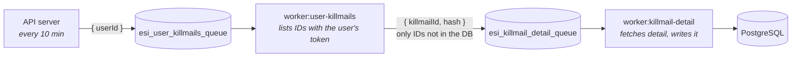

# User Killmail Sync

How KillReport fetches the killmails of a user who logged in with EVE SSO.

ESI lists a character's recent killmails only to that character's own access
token, so this is the one killmail source that needs a logged-in user. It has no
zKillboard dependency.

## The short version



Two stages, two workers. Both have to be running for a user's killmails to
arrive:

```bash
cd backend
yarn worker:user-killmails     # stage 1: list
yarn worker:killmail-detail    # stage 2: detail and write
```

`yarn worker:killmail-detail:rs` is the Rust detail worker. It reads the same
queue and writes the same rows, so run one or the other.

Nothing else needs starting. The API server (`yarn dev:backend`) publishes the
jobs itself.

## Step by step

### 1. Login stores the token

The SSO login asks for the `esi-killmails.read_killmails.v1` scope
([`config.ts`](../../src/config/config.ts)) and stores `access_token`,
`refresh_token` and `expires_at` on the user's row in `users`. Login queues
nothing. The user's first sync starts on the next cron tick, within 10 minutes.

### 2. The API server queues users who are due

[`killmail-sync-cron.ts`](../../src/services/killmail-sync-cron.ts) runs inside
the API server. It is started in `server.ts`, runs once at startup, then every
10 minutes. Each tick:

1. **Checks the broker first.** If `esi_user_killmails_queue` or
   `esi_killmail_detail_queue` has no consumer, or still has messages waiting,
   the tick publishes nothing. A stopped worker therefore never builds up a
   backlog of duplicate jobs.
2. **Selects the users who are due:** a refresh token is stored, the access
   token is valid for at least another 5 minutes, and `last_killmail_sync_at`
   is null or older than 15 minutes.
3. **Publishes one message per user** with priority 3:

   ```json
   { "userId": 42, "queuedAt": "2026-11-17T10:00:00.000Z" }
   ```

   A user who has never synced (`last_killmail_sync_at` is null) also gets
   `"fullSync": true`. Step 3 explains why.

The message carries no token and no character ID. The worker reads both from
the database, so a token rotated since publishing is never stale
([`killmail-sync-message.ts`](../../src/services/killmail-sync-message.ts)).

### 3. `worker:user-killmails` lists the killmail IDs

[`worker-esi-user-killmails.ts`](../../src/workers/worker-esi-user-killmails.ts)
handles one user at a time (`prefetch(1)`) and waits 10 seconds between users.

1. **Token.** `loadUserCredentials`
   ([`user-credentials.ts`](../../src/services/user-credentials.ts)) returns a
   valid access token, refreshing it first, under a row lock, if it expires
   within 5 minutes. A missing user, no refresh token or a revoked grant
   (`invalid_grant`, which clears the refresh token) is acked and skipped; an
   SSO outage is retried.
2. **List and record.** `CharacterService.getKillmailPage` reads
   `GET /characters/{id}/killmails/recent/` page by page, newest first, and
   each page is recorded in `killmail_refs`. It stops on a 404, an empty page,
   `X-Pages`, 14 pages, or a page that added no new ref (unless it is a full
   sync: `--full`, or a user who has never synced).
3. **Stamp.** Sets `users.last_killmail_sync_at`. The cron's 15-minute window
   reads this column.
4. **Hand off.** Nothing is published here. `queue:killmail-refs` publishes
   the refs that have no killmail yet to `esi_killmail_detail_queue`; see
   [killmail-refs.md](../workers/killmail-refs.md).

**Why a first sync is always full.** The cursor counts every killmail in the
database, not only the ones this sync wrote. RedisQ writes the whole EVE feed,
so a brand-new user usually has a recent killmail stored already. An
incremental first sync would stop on it at the top of page 1 and never fetch
the history. This is why `isFullSync`
([`killmail-sync-message.ts`](../../src/services/killmail-sync-message.ts))
sends `fullSync` for a user who has never synced, whoever publishes the job.

### 4. `worker:killmail-detail` writes them

[`worker-killmail-detail.ts`](../../src/workers/worker-killmail-detail.ts)
needs no token, because `GET /killmails/{id}/{hash}/` is public. The worker
does not know which stage published a message. User sync, corporation sync and
the zKillboard sync all feed the same queue.

For each message it fetches the detail and calls `saveKillmail`
([`killmail-writer.ts`](../../src/services/killmail-writer.ts)), the only place
a Node process writes a killmail. One transaction writes everything:
`killmails`, `victims`, `attackers`, `killmail_items`, the daily leaderboard
aggregates and the `killmail_filters` row. Its first statement claims the
`killmails` row (`ON CONFLICT DO NOTHING`). A killmail that already exists
returns `false` and is not an error, because two sources can find the same
killmail. A failure anywhere rolls the whole killmail back, so it is never left
without its stats or filter row.

When a message's `announce` is true, the worker also publishes `NEW_KILLMAIL`
for GraphQL subscriptions and queues a Discord webhook job after the commit.
`queue-killmail-refs` always sends `false`: synced killmails are history, not
news.

The Rust worker
([`worker-killmail-detail`](../../../backend-rs/workers/worker-killmail-detail/))
does the same through
[`killmail-writer`](../../../backend-rs/crates/killmail-writer/), with the same
rows, values and transaction. It logs a failed announcement and still acks the
message, since a retry would only find the killmail already stored.

## Errors and retries

Both workers share `handleWorkerError`
([`worker-error.ts`](../../src/workers/worker-error.ts)):

- **ESI throttle (420/429):** requeued at once without using up an attempt. The
  shared ESI limiter holds the brake.
- **404:** warned and skipped.
- **Anything else:** retried through the broker, and parked in
  `killreport.parking` after five attempts.

Every ESI call goes through `esiClient` and the shared limiter. Neither worker
paces ESI itself. The 10-second wait between users is the only exception.

A killmail that parks leaves a gap the incremental sync never refills, because
the cursor is a `MAX()` and the gap sits below it. The parking queue is the
record of what is missing.

## Running it by hand

```bash
cd backend
yarn queue:user-killmails            # users not synced in the last 15 minutes
yarn queue:user-killmails --force    # every user with a valid token
yarn queue:user-killmails --full     # ignore the cursor, list up to 50 pages
```

The script selects users the same way the cron does. Users who have never
synced get a full sync with or without `--full`, because the script and the
cron make that call through the same function, `isFullSync`. The script
differs from the cron in two ways: it publishes at priority 5, and it does not
check the broker first.

## Checking on it

```graphql
query {
  workerStatus {
    queueName
    messageCount
    consumerCount
  }
}
```

A queue with messages and no consumer means its worker is not running. While
that lasts, the cron holds off and reports the reason in the debug log.

```sql
-- When was each user last synced?
SELECT character_name, last_killmail_sync_at FROM users ORDER BY last_killmail_sync_at DESC NULLS LAST;
```

`users.last_killmail_id` is no longer read or written. The cursor now comes
from `killmail_filters`.

## Corporation killmails

The corporation sync is the same pipeline with different inputs:
`esi_corporation_killmails_queue`, `worker:corporation-killmails`, the
`esi-killmails.read_corporation_killmails.v1` scope and
`last_corp_killmail_sync_at`. The same cron class runs it
(`CORPORATION_SYNC_JOB`), and it feeds the same detail queue. See
[corporation-killmail-sync.md](../workers/corporation-killmail-sync.md).

## Files

| Stage               | File                                                                                                |
| ------------------- | --------------------------------------------------------------------------------------------------- |
| Scheduling          | [`services/killmail-sync-cron.ts`](../../src/services/killmail-sync-cron.ts)                        |
| Sync message        | [`services/killmail-sync-message.ts`](../../src/services/killmail-sync-message.ts)                  |
| Manual queue script | [`queues/queue-user-esi-killmails.ts`](../../src/queues/queue-user-esi-killmails.ts)                |
| List worker         | [`workers/worker-esi-user-killmails.ts`](../../src/workers/worker-esi-user-killmails.ts)            |
| Token refresh       | [`services/user-credentials.ts`](../../src/services/user-credentials.ts)                            |
| Walk and refs       | [`services/killmail-walk.ts`](../../src/services/killmail-walk.ts)                                  |
| ESI list call       | [`services/character/character.service.ts`](../../src/services/character/character.service.ts)      |
| Hand-off to detail  | [`queues/queue-killmail-refs.ts`](../../src/queues/queue-killmail-refs.ts)                          |
| Detail worker       | [`workers/worker-killmail-detail.ts`](../../src/workers/worker-killmail-detail.ts)                  |
| Writer              | [`services/killmail-writer.ts`](../../src/services/killmail-writer.ts)                              |
| Rust detail worker  | [`backend-rs/workers/worker-killmail-detail/`](../../../backend-rs/workers/worker-killmail-detail/) |
| Rust writer         | [`backend-rs/crates/killmail-writer/`](../../../backend-rs/crates/killmail-writer/)                 |
| systemd units       | [`deploy/systemd/`](../../../deploy/systemd/), see [systemd.md](../ops/systemd.md)                  |
