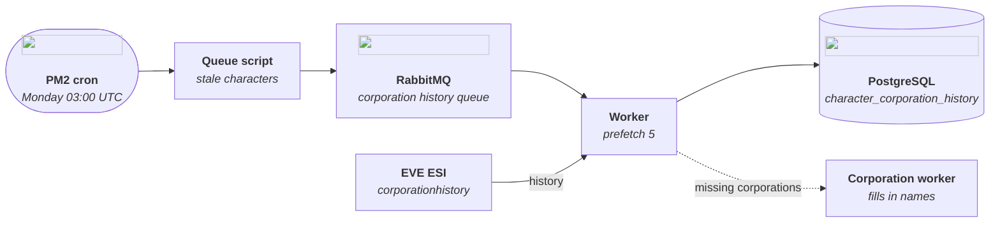
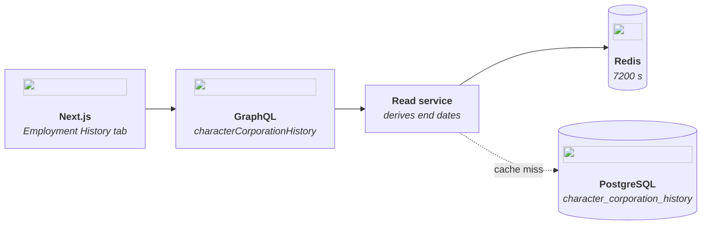

# Character Corporation History

Every corporation a character has been a member of, shown in the **Employment
History** tab of the character page (`/characters/{id}?tab=employment`).

One queue, one worker, one table. The worker is the sole writer of
`character_corporation_history`.

## Flow

### Write path



### Read path



## Commands

All of them run from `backend/`.

| Command                                         | What it does                                                                                    |
| ----------------------------------------------- | ----------------------------------------------------------------------------------------------- |
| `yarn queue:character-corporation-history`      | Queues every character whose history was never fetched or is older than 6 days                  |
| `yarn queue:character-corporation-history <id>` | Queues only the given character(s), regardless of age. Several IDs separated by spaces work too |
| `yarn worker:character-corporation-history`     | Consumes the queue: fetches from ESI, saves, queues missing corporations                        |
| `yarn worker:info:corporations`                 | Resolves the corporations the worker queued, so names appear instead of IDs                     |

The queue script exits when it has finished queueing. The worker keeps running
and waits for new messages; stop it with `Ctrl+C`. When the queue drains it
logs `✅ queue completed!` with the totals.

## Typical tasks

### Refresh one character

```bash
yarn queue:character-corporation-history 95465499
yarn worker:character-corporation-history
```

The page can keep showing the old list for up to two hours afterwards, because
the read service caches it for 7200 s. To see the new data at once, delete the
key (add `-n <db>` if `REDIS_URL` ends in a database number):

```bash
redis-cli DEL character:corporation-history:95465499
```

### Backfill everyone

On the first run, every character counts as "never fetched", so the plain queue
script queues the whole `characters` table — one ESI request per character.
Leave the worker running in a second terminal. Run `worker:info:corporations`
as well, or new corporations show up as bare IDs.

Stopping halfway loses nothing. Run the queue script again and it queues only
the characters that are still missing or stale; the database, not RabbitMQ, is
the record of what is done.

### Check progress

```sql
SELECT COUNT(DISTINCT character_id) FROM character_corporation_history;
SELECT COUNT(*) FROM characters;
```

Queue depth through the API:
`query { workerStatus { queueName messageCount consumerCount } }`.

## Schedule

In production PM2 runs both processes (`ecosystem.config.js`, described in
[pm2.md](../ops/pm2.md)):

- `queue-character-corporation-history` — `cron_restart: '0 3 * * 1'`, every
  Monday 03:00 UTC.
- `worker-character-corporation-history` — always on.

The threshold is 6 days rather than 7 on purpose. A character fetched a little
after last Monday's run started is slightly under 7 days old at the next run;
with a 7-day threshold it would be skipped and refresh only every two weeks.

## Data

`character_corporation_history`
([model](../../prisma/schema/characterCorporationHistory.prisma)):

| Column           | Meaning                                                                    |
| ---------------- | -------------------------------------------------------------------------- |
| `record_id`      | ESI's record ID, primary key; re-fetching upserts instead of duplicating   |
| `character_id`   | Indexed                                                                    |
| `corporation_id` | Not a foreign key; the corporation may not be in `corporations` yet        |
| `start_date`     | When the character joined                                                  |
| `is_deleted`     | The corporation has since closed — shown as `(Closed)`; `false` if absent  |
| `fetched_at`     | Stamped on all of a character's rows on every fetch; `MAX` is "last fetch" |

ESI gives only a start date. The read service derives each record's end from the
next, newer record's start; the newest record has no end and is shown as "to
this day". Rows are ordered `start_date DESC, record_id DESC`, and NPC
corporations are kept.

## Code

| Part           | File                                                                                                              |
| -------------- | ----------------------------------------------------------------------------------------------------------------- |
| ESI call       | [character.service.ts](../../src/services/character/character.service.ts) — `getCorporationHistory`               |
| Writer         | [character-corporation-history-writer.ts](../../src/services/character/character-corporation-history-writer.ts)   |
| Worker         | [worker-character-corporation-history.ts](../../src/workers/worker-character-corporation-history.ts)              |
| Queue script   | [queue-character-corporation-history.ts](../../src/queues/queue-character-corporation-history.ts)                 |
| Read service   | [character-corporation-history.service.ts](../../src/services/character/character-corporation-history.service.ts) |
| GraphQL schema | [CharacterCorporationHistory.graphql](../../src/schemas/CharacterCorporationHistory.graphql)                      |
| Resolver       | [corporation-history.ts](../../src/resolvers/character/corporation-history.ts)                                    |
| Tab component  | [EmploymentHistoryList.tsx](../../../frontend/src/components/EmploymentHistoryList/EmploymentHistoryList.tsx)     |
| Day count      | [employmentDays.ts](../../../frontend/src/utils/employmentDays.ts)                                                |

Design and plan:
[spec](../../../docs/superpowers/specs/2026-10-25-employment-history-design.md),
[plan](../../../docs/superpowers/plans/2026-10-25-employment-history.md).

## Not built yet

- Refreshing when the tab is opened. It needs a mutation that queues the
  character at high priority, the query taken out of the response cache, and
  the worker deleting the service key after it writes (spec §8).
- An empty result (`[]`) is cached for 7200 s like any other, so a character
  fetched just after someone opened the tab stays empty until the key expires.
- A GraphQL error renders as the empty-state text, `No employment history yet.`
