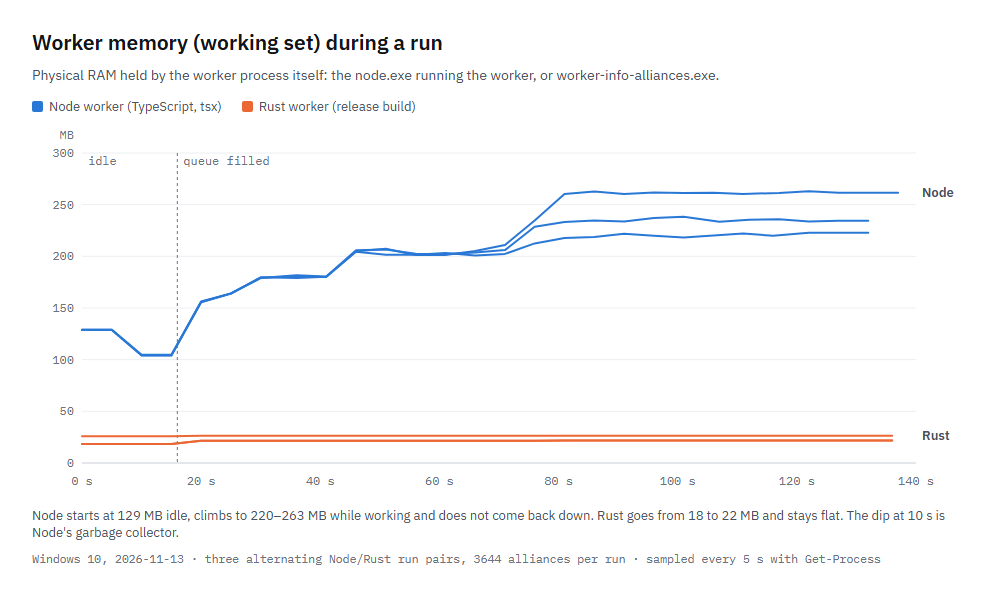
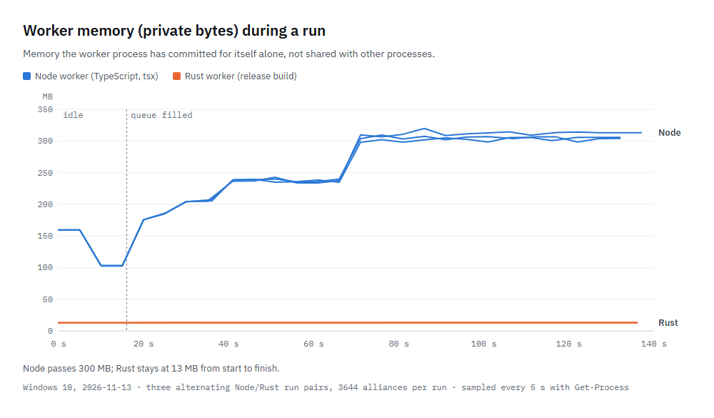
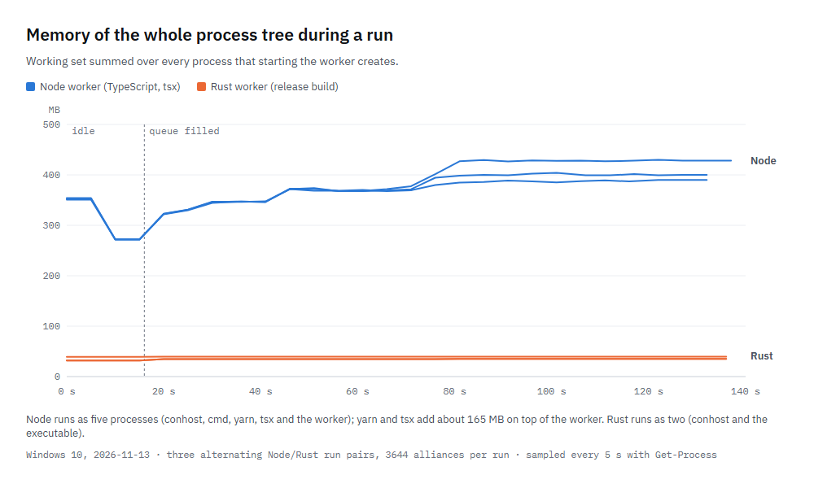
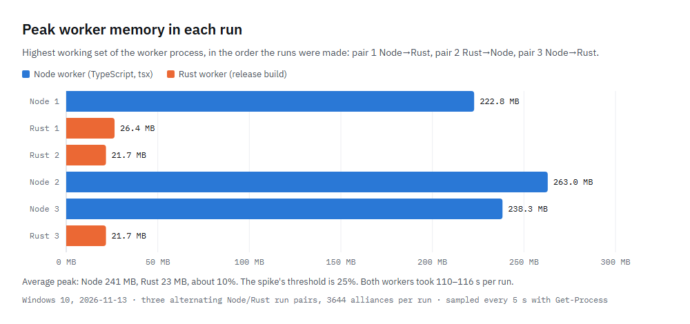

# Rust worker denemesi — aşama 1, Windows koşularının ham verileri

Sonuçlar ve yorumu spec'te:
[`../../specs/2026-11-12-rust-worker-spike-design.md`](../../specs/2026-11-12-rust-worker-spike-design.md),
bölüm _Sonuçlar (aşama 1)_. Bu klasör o bölümün dayandığı verileri saklar.

| Dosya               | İçerik                                                                                                                                                                                                                    |
| ------------------- | ------------------------------------------------------------------------------------------------------------------------------------------------------------------------------------------------------------------------- |
| `run-compare.ps1`   | Koşuları yapan PowerShell script'i, çalıştırıldığı haliyle. Ölçüm klasörü ve repo yolları bu makineye özgü. İlk argüman kaldığı yerden devam edilecek koşu (ör. `rs-1`).                                                  |
| `durations.csv`     | Her koşunun süresi: kuyruklamanın başından ilk "queue completed" satırına kadar, 5 s'lik sessizlik penceresi düşülmüş.                                                                                                    |
| `mem-<koşu>.csv`    | 5 saniyede bir bellek örneği: koşunun başından geçen saniye, zaman, worker sürecinin `WorkingSet64` ve `PrivateMemorySize64` değeri, süreç ağacının toplamları ve ağaçtaki süreç sayısı (bayt). İlk 15 s worker boştadır. |
| `csv-checksums.txt` | Her koşudan sonra alınan `alliances` CSV'sinin SHA-256 özeti ve satır sayısı, ısınma koşusu dahil. Özetlerin hepsi aynı.                                                                                                  |
| `log-excerpts.txt`  | Her worker log'unun özet satırı, işlenen alliance satırı sayısı ve alliance satırları dışında hata yoluna ait satır sayısı.                                                                                               |
| `figures/*.png`     | `mem-*.csv` verisinden çizilen dört grafik (İngilizce): worker'ın Working Set'i, Private Bytes'ı ve süreç ağacının toplamı zamana göre, ve koşu başına en yüksek değer.                                                   |
| `figures.html`      | Grafikleri çizen sayfa. `?fig=ws`, `private`, `tree` veya `peak` ile tek grafik açar; PNG'ler bundan headless Chrome ile alındı, komut dosyanın başında.                                                                  |

## Grafikler

Repoya alınmayanlar: CSV'lerin kendisi (yedi aynı dosya; özetleri yukarıda),
log'ların tamamı (satır başına bir alliance) ve ölçüme katılmayan ısınma
koşusunun bellek örnekleri. Log'larda `420`, `429` gibi sayılar hem alliance
adlarında ("420 Chronicles of EvE") hem sıra numaralarında (`✅ [420]`) geçiyor,
Node log'undaki `❌ [worker] pool connection closed` satırları da boşta kalan
bağlantının kapanışı; bu yüzden sayımlar alliance satırları dışında yapıldı.
